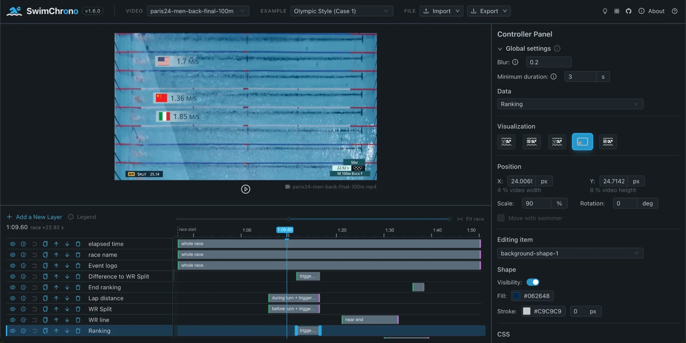

# Replicating Paper Results

This page gives step-by-step instructions to replicate the tool figures in the paper ["Diving Deep into Time: Temporal Arrangements for Embedded Visualization in Swimming Videos"](https://doi.org/10.1109/TVCG.2026.3689361) (Figures 4–6). No API key or backend is required — the optional AI assistant is not involved in these steps.

## 1. Run the system

```bash
yarn
yarn run dev
```

Then open [http://localhost:5173/SwimChrono/](http://localhost:5173/SwimChrono/) (see [README](../README.md) for details). Alternatively, use the online version at https://ahugh19.github.io/SwimChrono/ — no local setup needed.

The authoring interface that opens is the tool shown in **Figure 4** of the paper (the screenshot below is the current version; the paper used `v1.0.0`):



## 2. Figure 4 — Case 1 (Olympic Style)

1. In the Header, make sure the *Video* dropdown is set to **paris24-men-back-final-100m** (it is the default race on start).
2. In the *Example* dropdown, select **Olympic Style (Case 1)**. The Case 1 configuration loads automatically: its layers appear in the timeline at the bottom, and the embedded visualizations are attached to the video.
3. Click the **play button below the video**. As the race plays, the embedded visualizations appear at the moments defined by their triggers.
4. To see the trigger settings, click the **clock icon** in each layer's row in the timeline; a trigger panel opens on the right.

The screenshot in **Figure 4c** was taken from this playback.

## 3. Figure 5 — Case 3 (Pac-man and Acceleration)

With the same video (**paris24-men-back-final-100m**) selected:

1. In the *Example* dropdown, select **Pac-man (Case 3)** and play the video.
2. Then select **Acceleration (Case 3)** and play again.
3. As in Case 1, click the **clock icon** in each layer's row to see its trigger settings in the panel on the right.

These two examples together correspond to **Figure 5** in the paper.

## 4. Figure 6 — The speed-climbing case

1. In the *Video* dropdown, select **Climbing**.
2. The **Climbing** example loads by itself once the video's data is in (it is the only enabled entry of the *Example* dropdown). Its four layers appear in the timeline; play the video to see the result.

This corresponds to **Figure 6** in the paper. Note that Figure 6 is composed of several video frames, each rotated 90° clockwise relative to the video as seen in the system (the wall appears horizontal in the tool and vertical in the paper). See [climbing-case.md](./climbing-case.md) for more about this case.

## 5. Customizing the results

The loaded examples are ordinary configurations — everything in them can be modified and customized. Select a layer in the timeline, click the name of the layer, then use the Controller Panel on the right to change the text, the position of texts and images, sizes, colors, and other element styles; the TriggerDrawer edits when each layer appears. You can export your modified configuration from the Header (**Export**) and re-import it later (**Import**).
